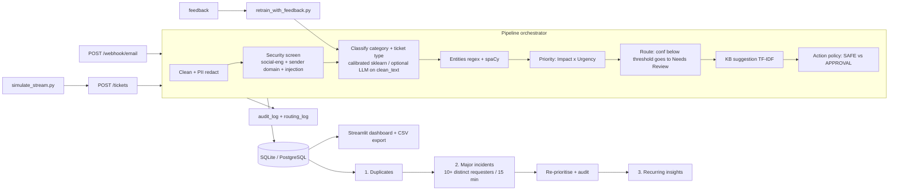

#IT_IQ_helpdesk - IT Helpdesk Ticket Triage & Analytics

An end-to-end ITSM workflow: ingest tickets (API + inbound-email webhook), redact PII, classify (Incident vs Service Request + category), apply ITIL priority, route with a human-in-the-loop gate, suggest a KB fix, detect duplicates and **major incidents**, quarantine social-engineering / prompt-injection attempts, and give managers an analytics dashboard with a business-impact calculator.

> **Data note:** all tickets are synthetic (generated, seeded, reproducible). Numbers show the system works on realistic *messy* data; they are not claims about a real helpdesk.

## The problem
L1 helpdesks are flooded with repetitive, vaguely worded tickets that get misrouted (24% in the baseline here), breach SLAs (misrouted tickets breach 33% vs 16%), and give no visibility into recurring root causes. See [docs/business_case.md](docs/business_case.md).

## Architecture


## Run it (3 commands)
Python 3.12 recommended (3.11+ works).
```bash
pip install -r requirements.txt
python -m scripts.bootstrap          # generate data -> train -> evaluate -> process history (~4 min)
streamlit run dashboard/Home.py      # dashboard on :8501   (API: uvicorn app.main:app  on :8000)
```
Live demo: start the API, then `python -m scripts.simulate_stream --n 30 --attacks --burst-outage` (watch a major incident open live). Tests: `pytest -q`.
Docker (`docker compose up`) files are included but were **not run on the author's machine** (Docker not installed there); CI builds the image.

## Features
* **Ingest:** `POST /tickets`, `POST /webhook/email` (parses `Name <addr>`, HTML->text, optional `WEBHOOK_TOKEN`, idempotent on `message_id`), live stream simulator.
* **Clean + PII redaction** *before* any processing/storage of processed text (phones, employee IDs, emails).
* **Classify:** TF-IDF (word + char n-grams) + calibrated Logistic Regression for **category** and **ITIL ticket type** (Incident / Service Request).
* **Entities:** devices/assets, apps, error codes, location, urgency keywords (regex + spaCy).
* **Priority:** ITIL Impact x Urgency -> P1-P4 ([rules](docs/priority_matrix.md)).
* **Route:** category -> resolver team; confidence below the data-driven threshold -> **Needs Review**; suspicious -> **Security Review**.
* **KB:** 20 markdown articles, TF-IDF retrieval, link attached.
* **Intelligence:** duplicate merge (runs first) -> major incident detection (>= 10 **distinct** requesters in 15 min -> P1 parent, children re-prioritised with audit entry) -> recurring-issue recommendations.
* **Audit:** every automated decision logged with timestamp, actor and reason.
* **Feedback loop:** `POST /feedback` -> `scripts/retrain_with_feedback.py` (promotes the new model only if held-out accuracy does not drop).
* **Dashboard (8 views):** Overview, ITSM KPIs, Trends, Incidents, Root-cause insights, Model performance, Security, Business impact; CSV export on every dataset for Power BI.

 <!-- placeholder: add screenshots -->
 <!-- placeholder -->
 <!-- placeholder -->

## Results (held-out test set, 582 tickets)
| | |
|---|---|
| Category accuracy / macro-F1 | 88.8% / 0.891 (~5% deliberate label noise caps the ceiling near 95%) |
| Ticket-type accuracy | 96.6% |
| Confidence threshold | **0.55**, chosen from the coverage-vs-accuracy curve: 91.9% auto-routed at 95.1% accuracy (rule logged in `metrics.json`) |
| Priority engine | 85% exact, 99.7% within one level |
| KB top-1 retrieval | 86% |
| Misroutes | 25.1% manual baseline vs 4.9% of auto-routed tickets |
| Major incident | email outage detected 6.6 min after the first ticket; 37 of 40 reports linked, 0 false links |
| Duplicates | 30/30 merged, 0 false merges |

## ITIL concepts used
Incident vs Service Request - Impact x Urgency priority matrix - SLA targets (P1 4h ... P4 72h) - MTTR / first-contact resolution - Major Incident Management (parent record, SLA tracked on the parent) - Problem management (recurring-issue root-cause insights) - Knowledge management (KB articles + deflection) - Service-desk escalation / hand-offs and reassignment cost - Change-controlled access (approval before access/password actions).

## Security design (details: [docs/security_design.md](docs/security_design.md))
* Ticket text is **untrusted**: it can never set priority, category-by-instruction, or trigger actions.
* The system **never auto-executes** password resets, unlocks, access grants or installs; a reset only yields `verification_required`.
* Social-engineering score combines urgency, authority claims, credential requests, verification bypass and **sender domain** (look-alike / free-mail); injection score needs >= 2 independent signals so "please ignore my previous ticket" is not flagged.
* Optional LLM (`USE_LLM=true`, needs `ANTHROPIC_API_KEY`) sees **only PII-redacted `clean_text`**, never `raw_body`; output must match a strict JSON schema; anything else falls back to scikit-learn. **The project works fully without any API key.**
* Detector results on the synthetic set: precision 1.00, recall 1.00, FPR 0.00 on 2,980 legitimate tickets (incl. 25 decoys) - **optimistic**, because the attacks and detector rules share an author.

## Limitations
* Synthetic, template-generated text overstates real-world accuracy; the hand-written eval set ships with 5 examples (add ~50 in `data/eval/handwritten_tickets.csv`).
* Detectors are pattern-based and paraphrase-evadable; the architecture (no auto-executed sensitive actions) is the real control.
* SLAs use calendar hours (no business-hours calendars, pauses or holidays); names in free text are not redacted.
* Reply/auto-ack emails are simulated (nothing is actually sent); Docker files unverified locally.

## Future scope
ServiceNow / Jira Service Management integration via REST (create/update incidents, push the assignment group, pull resolution notes as feedback), SSO for the dashboard, business-hours SLA engine, a real verified-channel approval flow, active-learning on the Needs Review queue, PostgreSQL + Alembic migrations.

## Layout
`app/` API + pipeline + intelligence + security | `ml/` train/evaluate | `data/` generator, KB, eval | `dashboard/` Streamlit | `scripts/` bootstrap, stream simulator, retraining | `tests/` 98 pytest tests | `docs/` business case, priority matrix, security design.
